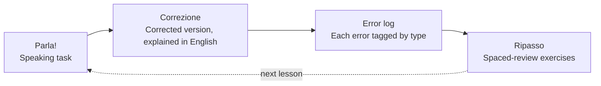

# Il mio percorso: draft course plan

A Nicos Weg-style Italian course built for you: a story set in Genoa's energy R&D world, a quick A2 refresh, then B1, aiming for B2. Draft for discussion, no tech stack yet.

- [Where to start](#where-to-start)
- [Story and characters](#story-and-characters)
- [Units by level](#units-by-level)
- [Anatomy of a lesson](#anatomy-of-a-lesson)
- [Your weak points, built in](#your-weak-points-built-in)
- [Open questions](#open-questions)

## Where to start

> **Recommendation:** Start with a 6-week Ripasso A2, then the full B1 course, with B2 as the target.

- Your recurring errors (articles, preposizioni articolate, agreement, gender) are A1–A2 grammar. They need fixing first, or they follow you into everything else.
- Your fluency and comprehension are already B1, so a full A2 course would bore you. A short, error-targeted refresh is enough.
- B1 is where the congiuntivo, condizionale and pronouns live. These are exactly what work meetings need.
- B2 is the realistic level for leading meetings, negotiating and writing formal reports in Italian.

**Ripasso A2:** 10 units, 30 lessons, about 6 weeks

**B1:** 19 units, 76 lessons, about 4 months

**B2:** 19 units, 76 lessons, about 4 months

**Pace assumed:** 5 lessons a week, 20–25 minutes each

## Story and characters

Adam, 31, an electrical engineer, moves to Genoa to work on grant-funded energy R&D projects at Energetica Ligure (a fictional company). Over one year he goes from newcomer to project lead, and the story covers work, bureaucracy and Genoese life side by side.

### Ripasso A2: Le prime settimane

Arrival, the flat, codice fiscale, first days at the office, first friends. Survival Italian, done properly.

### B1: Il primo progetto

Kick-off, Gantt, risk assessment, cost plan, first SAL, a Horizon proposal, residenza and ASL. It ends with Adam offered the lead.

### B2: Il coordinatore

Leading a consortium, negotiating budgets, handling conflict, an EU audit, a tax return, buying a flat. It ends with a funded project.

**Adam** — Protagonist

Engineer, new in Genoa, good at his job and still finding his words in Italian

**Giulia Ferrando** — Project manager and mentor

Genoese and direct; corrects his English words in meetings

**Marco Parodi** — Senior grid engineer

SCADA and networks expert; talks fast and uses dialect expressions

**Elena Bruzzone** — Amministrazione

Cost plans, SAL and rendicontazione; a precise, formal register

**Signora Pina** — Landlady

Guide to bureaucracy, the neighbourhood and how to make pesto properly

**Luca** — Friend from padel

Everyday, informal Italian: weekends, food, the Riviera

**Sofia** — Partner from Madrid

Another foreigner in the consortium, so she makes different mistakes than Adam

## Units by level

Each unit has one grammar focus; earlier points come back in later exercises.

### Ripasso A2

Ripasso A2: 10 units × 3 lessons. Short, fast, and built around your recurring errors. It also covers the story's first weeks in Genoa.

| # | Unit | Story beat | Grammar focus | Vocab / function |
| --- | --- | --- | --- | --- |
| 1 | Arrivo a Genova | Adam lands at Piazza Principe and meets his landlady, Signora Pina | Articles: il / lo / l' / la, i / gli / le; gender basics | Greetings, presenting yourself |
| 2 | Una casa nei caruggi | Lost in the centro storico looking for the flat | Articulated prepositions: sul, nel, dal, della, agli | Directions, rooms, the house |
| 3 | Il codice fiscale | First trip to the Agenzia delle Entrate | Noun–adjective agreement and plurals (la relazione → le relazioni, il problema → i problemi) | Documents, queues, office hours |
| 4 | Primo giorno in ufficio | Meets Giulia and Marco at Energetica Ligure | Present tense: regular and key irregulars (essere, avere, fare, andare, venire, dovere, potere, volere) | Roles, the workplace, the team |
| 5 | Al bar e in focacceria | Morning focaccia and cappuccino with the team | Partitive del / dei / degli / delle, and ne | Ordering, quantities, food |
| 6 | Il weekend a Boccadasse | Monday: telling colleagues about the weekend | Passato prossimo with avere vs essere, participle agreement | Free time, places, weather |
| 7 | Com'era a casa? | Lunch: colleagues ask about his life before Genoa | Passato prossimo vs imperfetto | Describing the past, habits |
| 8 | Il meeting? No, la riunione! | Giulia teases Adam for using English words | Gender of borrowed words (il budget, la mail); Italian alternatives (riunione, impostazioni, percorso) | Meeting basics, false friends, invented words |
| 9 | Mi alzo alle sette | Building a routine in the new city | Reflexive verbs; direct pronouns lo / la / li / le | Daily routine, time |
| 10 | La settimana prossima | Planning his first week of real work | Futuro semplice; review of units 1–9 | Plans, appointments, the calendar |

### B1

B1: 19 units × 4 lessons, the main course. Congiuntivo gets four units plus spiral review.

| # | Unit | Story beat | Grammar focus | Vocab / function |
| --- | --- | --- | --- | --- |
| 1 | Il kick-off | First project meeting with the consortium | Indirect pronouns gli / le; direct vs indirect | Introducing your role in a meeting |
| 2 | Il Gantt | Adam builds the project timeline with Giulia | Futuro semplice and futuro anteriore | Scadenze, milestone, slittare, rispettare i tempi |
| 3 | All'ASL | Registering with a medico di base | Pronominal verbs (iscriversi, rivolgersi, occuparsi di) | Tessera sanitaria, appointments |
| 4 | Il rischio della rete | Adam explains risk assessment to new colleagues | Relative pronouns che / cui / il quale | Explaining concepts: si tratta di, serve a, cioè |
| 5 | Si fa così | Walking through network mapping step by step | Si impersonale and si passivante | Describing processes: asset, topologia, alimentare |
| 6 | Il piano dei costi | Elena from amministrazione reviews the budget | Comparatives, superlatives, numbers and percentages | Costi del personale, spese generali, cofinanziamento |
| 7 | Penso che sia giusto | Brainstorming a Horizon proposal | Congiuntivo presente after opinion verbs (penso che, credo che) | Giving and asking for opinions |
| 8 | Voglio che tu… | Adam has to delegate tasks for the first time | Congiuntivo after volere / sperare / bisogna che (tu sia, non tu esse) | Requests, delegating, expectations |
| 9 | In Comune | Requesting residenza at the Anagrafe | Imperativo: formal (Lei) and informal (tu) | Following instructions at uffici |
| 10 | Pranzo coi colleghi | Pesto, farinata and office gossip | Ci and ne; combined pronouns (glielo, me ne) | Small talk, Genoese food |
| 11 | Il SAL | First progress report to the funder | Trapassato prossimo; past tenses in reporting | Stato di avanzamento, deliverable, ritardi |
| 12 | Un problema col fornitore | A supplier delivers late | Condizionale presente for polite requests and advice | Formal emails, complaints, suggestions |
| 13 | Sto lavorando… | Weekend in Camogli, a call from work interrupts | Stare + gerundio; stare per | Describing ongoing actions, leisure |
| 14 | La revisione | The reviewer's comments are harsh | Condizionale passato (avrei dovuto) | Giving and receiving feedback, regrets |
| 15 | Il product owner | Adam takes over the backlog | Connectors: quindi, però, invece, mentre, siccome, anche se | Structuring an argument, priorities |
| 16 | Bollette e contratto | Reading the rental contract and energy bills | Verbs with fixed prepositions (pensare a, dipendere da, fidarsi di) | Affitto, utenze, caparra |
| 17 | Il verbale | Writing the minutes of a meeting | Indirect speech (present) | Reporting who said what |
| 18 | Spero che sia andato bene | Waiting for the evaluation results | Congiuntivo passato | Hopes, worries, reassurance |
| 19 | Un anno a Genova | Giulia offers Adam the lead on a new proposal | Periodo ipotetico (types 1 and 2, intro); review | Talking about the future, ambitions |

### B2

B2: 19 units × 4 lessons. Outline only for now; we refine it once B1 is underway.

| # | Unit | Story beat | Grammar focus | Vocab / function |
| --- | --- | --- | --- | --- |
| 1 | Il nuovo ruolo | Adam becomes project coordinator | Congiuntivo imperfetto | Taking responsibility, setting goals |
| 2 | Negoziare il budget | Partners fight over the budget split | Periodo ipotetico type 2 | Negotiating, compromise |
| 3 | La riunione di consorzio | General assembly with Italian partners in Rome | Periodo ipotetico type 3 | Chairing a meeting, keeping the floor |
| 4 | Presentazione tecnica | Adam presents risk results to the utility | Nominalisation and formal register | Presenting data and charts |
| 5 | Tutto torna | Untangling a miscommunication | Concordanza dei tempi | Clarifying, rephrasing |
| 6 | Va fatto entro venerdì | Crunch week before a deadline | Passive with venire and andare | Obligations, urgency |
| 7 | Finita la riunione… | After-meeting decisions in the corridor | Gerundio and participio assoluto | Summarising decisions |
| 8 | Ha detto che avrebbe… | Reporting a partner's broken promise | Indirect speech (past) | Reporting and holding people accountable |
| 9 | Il conflitto | Marco and a partner clash | Benché, sebbene, nonostante + congiuntivo | Mediating, diplomacy |
| 10 | Il 730 | First Italian tax return | Impersonal and bureaucratic forms | Dichiarazione dei redditi, CAF, detrazioni |
| 11 | Il report finale | Writing a formal deliverable | Complex relatives (il cui, la quale) | Formal written Italian |
| 12 | Fallo controllare | Delegating reviews to the team | Fare and lasciare + infinito | Causing and allowing actions |
| 13 | Una casa tutta mia | Looking at flats to buy, mortgage talk | Futuro and condizionale for guesses | Mutuo, rogito, notaio |
| 14 | Come si dice a Zena | A Genoese dinner full of idioms | Pronominal verbs (farcela, cavarsela, metterci, andarsene) | Modi di dire, a bit of genovese |
| 15 | Il miglior team che abbia avuto | Year-end feedback to the team | Congiuntivo after superlatives and relatives | Praise, constructive criticism |
| 16 | L'audit | EU financial audit of the project | Passive and bureaucratic register, review | Rendicontazione, giustificativi |
| 17 | Il workshop | Running a stakeholder workshop | Discourse markers (insomma, comunque, cioè, anzi) | Facilitating, handling questions |
| 18 | Al telegiornale | Energy crisis on the news | Journalistic register, reading comprehension | Following news and debates |
| 19 | Finanziato! | The proposal wins; Adam gives the opening talk | Full review | Public speaking, closing remarks |

## Anatomy of a lesson

> **Superseded for the app (2026-11-15):** the lesson order follows `SPEC.md` (DW's order: scene → exercise steps ending with Parla! → results → grammar → vocabulary → culture). The content below still describes what a lesson covers.

About 20–25 minutes.

1. **La scena** — Illustrated scene with dialogue audio, 1–2 minutes, plus one gist question before you listen
2. **Hai capito?** — Comprehension: true/false, put the lines in order, who said what
3. **Grammatica** — One point, explained in English, with examples taken from the scene
4. **Esercizi** — Fill-ins, transformations and multiple choice, plus 2–3 items drawn from your own error log
5. **Vocabolario** — 10–15 words with article and gender always shown (l'asset, la metrica), audio, and spaced-repetition flashcards
6. **Il copione** — Full script; tap any line for the English translation
7. **Cultura** — A short note: Genoese life, Italian bureaucracy, or Italian workplace habits
8. **Parla!** — Speaking task tied to the scene (for example, explain this to Giulia). I read back the corrected version, explain the fixes in English and log the errors

## Your weak points, built in

| Error seen | Example | Main unit | Then |
| --- | --- | --- | --- |
| Articles before vowels | il Italian Bro → l'Italian Bro | A2.1 | Every lesson's vocab shows the article |
| Partitive and masculine plurals | delle esercizi → degli esercizi | A2.5 | Recurring fill-ins |
| Gender of English words | le meeting, delle step | A2.8 | Anglicism drills in work units |
| Preposizioni articolate | su il calcolo → sul calcolo | A2.2 | Spiral review across B1 |
| Plural agreement | siamo responsabile, le relazione | A2.3 | Transformation exercises |
| Congiuntivo after volere che | tu esse → tu sia | B1.7–8 | B1.18, B2.1, B2.9, B2.15 |
| Invented words | attentivo → attento | A2.8 | Flagged in every Parla! correction |
| English fallback words | journey, settings, vulnerable | A2.8 | Personal glossary built from your speech |

## Open questions

> **Status (2026-11-15):** 4 and 5 are settled in `SPEC.md` (in-app self-rating, with AI correction later; standard Italian voices). 6 is a later app milestone. The rest are parked as content decisions.

1. Protagonist: someone with your background, or a neutral newcomer? Do you like the name Adam?
2. Keep the employer fictional, or model it closely on STAM and your real projects?
3. Time budget: are 20–25 minute lessons, 5 days a week, realistic?
4. Speaking: practise by calling me, or record inside the app?
5. Audio: a light Genoese accent for some characters, or standard Italian only?
6. Run a short placement test first, to skip any Ripasso A2 units you already master?
7. Which work topics matter most right now, for example upcoming meetings or proposals, so they come earlier in B1?
